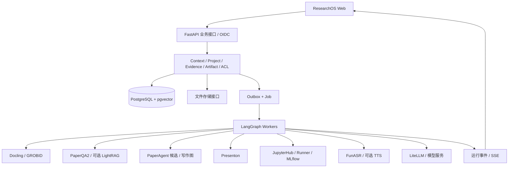

# ResearchOS 开发文档：功能拆解与开源复用方案

> 需求来源：[功能预想.md](./功能预想.md)，全文 1,789 行。调研日期：2026-10-30。
> 本文是实施方案，覆盖原文八大功能模块、20 个 Agent、六项 Agent 能力、十项扩展功能及基础设施。项目能力依据仓库 README、许可证和官方资料核对；尚未进行部署、性能测试或代码级审计。“推荐”是架构判断，不代表已经集成成功。

> 覆盖复核说明：初稿已映射全部主要模块，但浏览器工具、通知、组会排期、实验图编辑及 Agent 评测等细项展开不足。本版已在第 20 节补齐方案，并列明延后、限域与待验证范围。“覆盖”指需求有去向，不表示已完成详细设计或实现。

阅读入口：[重点项目选型](#2-重点项目选型) · [驾驶舱](#3-功能逐项映射科研驾驶舱原文第-3-节) · [文献](#4-功能逐项映射文献情报中心原文第-4-节) · [知识大脑](#5-功能逐项映射知识大脑原文第-5-节) · [写作](#6-功能逐项映射学术写作原文第-7-节) · [实验](#7-功能逐项映射实验研究中心原文第-6-节) · [组会](#8-功能逐项映射组会与汇报原文第-8-节) · [项目与团队](#9-功能逐项映射项目管理与学术协作原文第-910-节) · [开发分期](#16-开发分期与验收)。若阅读器不支持标题锚点，可按章节编号查找。

## 1. 开发结论

**采用“统一 ResearchOS 业务层 + 可替换的开源能力服务”，优先部署和调用现成项目，只自研科研对象、证据链、权限及跨模块业务。**

原文的大部分单项能力有现成实现：PDF 解析用 Docling/GROBID，文献问答用 PaperQA2，论文生成优先验证 PaperAgent，PPT 用 Presenton，在线实验用 JupyterHub，实验记录用 MLflow，转写用 FunASR，Agent 编排用 LangGraph。真正缺少通用现成替代的是“某次组会决定了某个实验，该实验的结果支持论文某个结论”这类贯穿科研流程的关联逻辑。

不建议把多个项目的前端、数据库和用户系统直接合并。每个项目先独立运行，通过适配器交换标准化输入与成果；ResearchOS 负责统一入口和数据关联。只有纯前端库直接嵌入页面。

### 1.1 实现方式与阶段

| 标记 | 含义 | 实际开发工作 |
| --- | --- | --- |
| 接入 | 已有产品或引擎承担主要能力 | 部署、鉴权、接口适配、结果回收 |
| 组装 | 用开源库组合功能 | 数据模型、组件、提示词、结构化输出与校验 |
| 自研 | 未找到可直接覆盖该科研业务的成熟方案 | 业务规则、状态关系、权限、评测与交互 |
| 试验 | 研究原型或效果不确定 | 隔离验证，通过后再纳入正式流程 |

阶段定义：P0 为基础工作台，P1 为科研资料到交付物闭环，P2 为实验与团队协作，P3 为自主科研等探索能力。阶段表示推荐实施顺序，不删除原始需求。

### 1.2 首选组合

| 领域 | 首选 | 采用方式 | 何时替换或补充 |
| --- | --- | --- | --- |
| 文献检索 | OpenAlex、arXiv、Crossref 官方接口 | 自研轻量聚合适配器 | 需要医学、计算机专项时加 PubMed、DBLP |
| PDF | Docling + PDF.js | 解析服务 + 阅读器组件 | 引用结构不佳时增加 GROBID |
| 文献问答 | PaperQA2 | Python 适配器 | 需要整套知识库后台时考虑 RAGFlow |
| 论文生成 | PaperAgent 候选，授权与样例验证通过后接入 | 独立写作 Worker | 未通过则用 LangGraph + 编辑器 + 文档转换工具组装 |
| PPT | Presenton | 独立服务 | 科研排版对照 PPTAgent 固定版本；模板兜底用 PptxGenJS |
| 知识与记忆 | PostgreSQL + pgvector；后续 LightRAG | 先统一事实，再增加图检索 | 有明确时态记忆需求再验证 Graphiti |
| 实验 | JupyterHub + MLflow + Git | 分别承担运行、记录、代码版本 | 参数搜索加 Optuna，大数据版本加 DVC |
| 会议 | FunASR；录音精修可选 WhisperX | ASR Worker | 语音答辩再增加 CosyVoice |
| Agent | LangGraph | 统一 Runtime + 角色配置 | 跨天流程和外部回调复杂后加 Temporal |
| 用户与权限 | Keycloak + ResearchOS 资源授权 | OIDC 登录 + 业务权限 | 不复用第三方应用的管理员会话 |

本文中未提供已经验证的外部接口路径。后文 `/api/v1/...`、工具名和 JSON 均为 **ResearchOS 拟定契约**，需按上游实际 API/CLI 实现适配。

## 2. 重点项目选型

### 2.1 PaperAgent：优先验证的论文生成组件

具体候选是 [songhahaha66/PaperAgent](https://github.com/songhahaha66/PaperAgent)，已核对其默认分支 README。它覆盖论文生成、代码计算、图表和文档导出，符合原文实验到写作的部分链路。另一个 [ji-xin/paperagent](https://github.com/ji-xin/paperagent) 主要是 arXiv 论文到 LaTeX 演示文稿，不能作为同一个写作系统看待。用户所说的 PaperAgent 未提供地址，因此本文将前者作为待验证候选。

**集成决策：不将 PaperAgent 整体改造成 ResearchOS，先把它作为“研究结果到论文草稿”的能力服务。**

接入顺序：

1. 确定具体 commit、依赖和授权。此次读取根目录 `LICENSE`、`LICENSE.md` 未成功，尚不能确认授权范围；公开可见不等于已取得修改和分发许可。此处不是认定仓库没有许可证。
2. 在独立容器和虚拟环境中试跑上游示例，再运行一个带真实实验 CSV、图表和参考文献的样例。
3. 适配 `WritingJob`：输入论文提纲、允许使用的文献与证据、实验结果版本、模板和预算；输出草稿、源码、引用表、日志与文件清单。
4. 在平台内导入产物并建立证据关系。上游内部 ID 与 ResearchOS ID 通过映射表关联，不共享业务数据库。
5. 上游未能消费的证据字段，由适配层保留并由平台校验，不能只把提示词写成“不要编造”。

当前 README 的运行环境、工作区和沙箱依赖已有特定要求，必须按固定版本部署，不假设与主应用 Python 环境兼容。若需要改造入口，改造应放在维护的薄分支中，避免长期重写上游。

**通过标准**：可处理给定材料、可中断恢复或明确重新执行、返回实际文件、引用不超出许可资料、图表可回查计算输入、失败不会报告成功。授权或技术验证未通过时，正式版本走第 6 节的组装路线。

### 2.2 PPT：Presenton 为主，PPTAgent 为备选

[Presenton](https://github.com/presenton/presenton) 提供自托管演示文稿生成与编辑能力，适合作为 PPT 服务；代码许可证为 Apache-2.0。ResearchOS 生成带证据的汇报内容，再提交给它排版，避免重复开发整套幻灯片编辑器。

[PPTAgent](https://github.com/icip-cas/PPTAgent) 代码为 MIT，但当前主分支已经以 Skill 工作流为主要入口。仓库明确给出了旧系统复现版本：PPTAgent `v0.2.0`、DeepPresenter `v1.1.38`。需要旧运行时、MCP 或论文复现时，分别核对对应 tag 的接口，不能把历史文档中的服务启动方式套到当前分支。

| 路线 | 使用场景 | ResearchOS 仍需完成 |
| --- | --- | --- |
| Presenton，默认 | 周报、开题、组会 PPT，用户继续编辑 | 提炼内容、来源关联、任务状态、文件归档 |
| PPTAgent，备选 | 对科研演示生成效果做对照评估 | 固定版本、运行容器、CLI/工具封装、版面验证 |
| PptxGenJS，兜底 | 固定实验报告、简洁模板、离线可控输出 | 模板和分页规则；它本身不负责理解论文 |

PPT 验收包含：中文字体、公式、表格溢出、图表数值、备注区引用、PPTX 内文字可编辑、PowerPoint/LibreOffice 打开情况。仅能导出整页图片不能等价于可编辑 PPT。学术模板是平台维护的样式，不宣称获得 Nature/IEEE 官方认证。

### 2.3 RAG、图谱和记忆：避免叠加多套系统

| 候选 | 核对结果 | 本项目决定 |
| --- | --- | --- |
| [PaperQA2](https://github.com/Future-House/paper-qa) | 科学文献问答与引用输出，支持迭代检索 | P0 优先；封装文献问答能力，证据定位另做统一映射 |
| [LightRAG](https://github.com/HKUDS/LightRAG) | 图与文本检索，可配置存储；MIT | P1 按图检索收益引入，不替代业务事实库 |
| [Graphiti](https://github.com/getzep/graphiti) | 时态上下文图谱，Apache-2.0 | P2 验证长期记忆，需额外后端与维护成本 |
| [Microsoft GraphRAG](https://github.com/microsoft/graphrag) | README 已注明主要处于维护模式 | 用于方法对照，不作为默认演进底座 |
| [RAGFlow](https://github.com/infiniflow/ragflow) | 完整 RAG 产品，Apache-2.0 | 团队需要现成知识库管理后台时可替换问答子系统，不与首选路线同时建设 |
| [Dify](https://github.com/langgenius/dify) | 可视化工作流产品，许可证有附加条件 | 可做独立原型；不作为默认多租户平台内核 |

这些项目解决的层次不同。论文里的方法、自己的实验结果、组会决策和文稿引用都必须先在 ResearchOS 建立稳定 ID；向量库和图谱是可重建的检索视图。第三方记忆模块不能成为“唯一科研事实来源”。

### 2.4 其他整套产品的取舍

| 方案 | 建议 | 原因与边界 |
| --- | --- | --- |
| [Zotero](https://github.com/zotero/zotero) | 接入导入导出和官方 API | 保留用户已有文献库，不重做桌面文献软件；不把托管同步服务视为可免费复制的后端 |
| [Overleaf CE](https://github.com/overleaf/overleaf) | 团队需要完整协同 LaTeX 时独立部署 | CE 与商业功能有边界；AGPL-3.0，账号联通与嵌入需单独验证 |
| [Plane](https://github.com/makeplane/plane) | 可选外部任务系统 | 已有大量项目管理 UI，但会增加部署、账号与数据同步成本；AGPL-3.0 |
| [OpenHands](https://github.com/OpenHands/OpenHands) | 代码 Agent 候选 | 复用代码操作能力，使用固定版本和隔离后端；不授予主机权限 |
| [AI-Researcher](https://github.com/HKUDS/AI-Researcher) | P3 对照试验 | 自动科研研究原型，先验证任务领域、依赖和授权，不直接作为生产核心 |
| [R&D-Agent](https://github.com/microsoft/RD-Agent) | P3 对照试验 | 借鉴提出方案与实验反馈循环；需要适配具体科研任务 |

## 3. 功能逐项映射：科研驾驶舱（原文第 3 节）

页面用 [shadcn/ui](https://github.com/shadcn-ui/ui) 组件和 [ECharts](https://github.com/apache/echarts) 图表组装，研究状态由平台计算；没有必要寻找整套“科研驾驶舱”项目。

| ID | 原始功能 | 复用/方式 | 需要实现的逻辑与验收 | 阶段 |
| --- | --- | --- | --- | --- |
| HOME-01 | 科研进度总览 | ECharts，组装 | 聚合里程碑及已完成任务；显示统计口径与时间 | P0 |
| HOME-02 | AI 科研日报 | LangGraph，组装 | 从事件增量生成，有来源链接，无活动时如实显示 | P1 |
| HOME-03 | 智能任务面板 | 平台 Task，组装 | 汇总待办、依赖、优先级，AI 建议接受后落库 | P0 |
| HOME-04 | 论文写作进度 | Tiptap/稿件版本，组装 | 按已确认章节状态统计，字数不等于完成度 | P1 |
| HOME-05 | 实验进度监控 | MLflow + Runner，接入 | 运行状态来自 Runner，指标来自 MLflow，禁止猜测进度 | P2 |
| HOME-06 | 阅读数量、方向与知识覆盖 | 文献/笔记事件，自研 | 去重统计；覆盖率标明相对于用户所选主题集合 | P0 |
| HOME-07 | 科研时间轴 | 事件列表，组装 | 任意条目能打开对应对象和版本 | P0 |
| HOME-08 | 学术热点雷达 | 检索订阅，组装 | 复用 RADAR，显示检索范围和新旧论文差异 | P1 |
| HOME-09 | 下一步科研建议 | Context Engine + Agent，自研 | 建议附依据、前提和接受按钮，不直接改变计划 | P1 |
| HOME-10 | 组会倒计时 | Meeting 时间，组装 | 时区与周期组会，取消会议不再提醒 | P0 |
| HOME-11 | 投稿倒计时 | 人工维护目标会议，组装 | 保存日期来源、时区与核实时间；可人工纠正 | P1 |
| HOME-12 | 科研能力画像 | ECharts，组装 | 复用 DNA，可查看指标定义和自评记录 | P3 |
| HOME-13 | Research Pulse 风险/机会 | 规则 + 检索 + Agent，自研 | 先计算异常次数、逾期等规则，再生成解释；保留证据与反馈 | P2 |

“连续三次收敛异常可能与学习率有关”拆成两步：异常次数是确定性统计，原因是待验证建议。两者必须分别存储和呈现。

## 4. 功能逐项映射：文献情报中心（原文第 4 节）

### 4.1 检索、来源与引用网络

| ID | 原始功能 | 复用/方式 | 集成实现与边界 | 阶段 |
| --- | --- | --- | --- | --- |
| LIT-01 | arXiv 检索 | [官方 API](https://info.arxiv.org/help/api/index.html)，接入 | 标题、作者、摘要、版本；按服务规定限速 | P0 |
| LIT-02 | OpenAlex 检索 | [官方资料](https://help.openalex.org/)，接入 | 论文、作者、机构和关联记录；上线时核实 key、额度与费用 | P0 |
| LIT-03 | Crossref 检索与 DOI | [REST API](https://www.crossref.org/documentation/retrieve-metadata/rest-api/)，接入 | 元数据补全、DOI 核验，缺失字段保持未知 | P0 |
| LIT-04 | Semantic Scholar | [API 文档](https://api.semanticscholar.org/api-docs/)，接入 | 引文/参考文献补充源；凭证与额度单独配置 | P1 |
| LIT-05 | PubMed | [NCBI E-utilities](https://www.ncbi.nlm.nih.gov/books/NBK25501/)，接入 | 生物医学可选连接器，保留 PMID/PMCID | P1 |
| LIT-06 | DBLP | [搜索 API](https://dblp.org/faq/How%2Bto%2Buse%2Bthe%2Bdblp%2Bsearch%2BAPI.html)，接入 | 计算机领域元数据与作者消歧辅助 | P1 |
| LIT-07 | IEEE/ACM | 授权接口/链接，接入 | 依据机构权限接入，未获授权仅保存元数据与外链 | P2 |
| LIT-08 | 自然语言检索 | LangGraph + 来源适配器，组装 | 解析主题/时间/领域，生成多语关键词并记录原查询 | P0 |
| LIT-09 | 研究问题驱动多轮检索 | 同上，组装 | 输出可追踪子问题，限制轮数与结果数量 | P1 |
| LIT-10 | 去重、相关性及质量筛选 | DOI/arXiv ID + 向量排序，自研 | 标题近似只提示合并；相关性与引用数分别展示 | P0 |
| LIT-11 | 引用/被引网络 | 数据源引用边 + Cytoscape.js，组装 | 区分真实引用边和语义相似边，支持按时间展开 | P1 |
| LIT-12 | 同作者、同方法与关键论文 | 来源元数据 + 抽取，组装 | 保存推荐理由，不将同名作者强制合并 | P1 |
| LIT-13 | 自动综述 | PaperQA2 + 写作流程，组装 | 只基于实际取得的文献；摘要与全文证据分级标注 | P1 |

外部接口是数据服务，不等于开源项目，也不等于全文授权。连接器应保存 `provider`、原始 ID、获取时间、原始响应版本及使用条件。此次 NCBI 页面受到浏览验证限制、Semantic Scholar 产品页访问受限，其配额与调用细节在实现前仍需重新核实。

### 4.2 阅读器及 AI 分析

| ID | 原始功能 | 首选复用/方式 | 平台需要完成 | 阶段 |
| --- | --- | --- | --- | --- |
| READ-01 | PDF 上传与阅读 | [PDF.js](https://github.com/mozilla/pdf.js)，组装 | 对象存储、上传校验、目录/正文/助手三栏 | P0 |
| READ-02 | 结构、章节识别 | [Docling](https://github.com/docling-project/docling)，接入 | 将解析结果转成标准块，保留页码和位置 | P0 |
| READ-03 | 公式识别与解释 | Docling + 模型，组装 | 保留原图与识别文本；低置信公式允许人工修正 | P1 |
| READ-04 | 图表提取 | Docling，接入 | 原图、图注与文献版本绑定，禁止用想象的图替代 | P0 |
| READ-05 | 参考文献与正文引文识别 | [GROBID](https://github.com/grobidOrg/grobid)，接入 | TEI 转换、引用匹配、DOI 校验 | P1 |
| READ-06 | 段落翻译 | LLM + 标准块，组装 | 对齐块 ID，保留原文，术语表按项目复用 | P0 |
| READ-07 | 全文双语对照 | [PDFMathTranslate](https://github.com/PDFMathTranslate/PDFMathTranslate)，可选接入 | 保留排版翻译；AGPL-3.0，先核实复用条件 | P1 |
| READ-08 | 高亮批注与阅读笔记 | PDF.js + Tiptap，组装 | 批注存页码/坐标/原文哈希，笔记可关联项目 | P0 |
| READ-09 | 语音朗读 | 浏览器语音；后续 CosyVoice，接入 | 段落播放、暂停、语速；浏览器音色和服务依设备而异 | P1 |
| READ-10 | 引用导出 | Zotero 导出兼容 + BibTeX/RIS，组装 | 导出规范化元数据，引用键稳定且可编辑 | P0 |
| READ-11 | 核心贡献总结 | PaperQA2 + 结构化输出，组装 | 每条贡献绑定原文块，不存在则返回未找到 | P0 |
| READ-12 | 动机分析 | 同上，组装 | 分开记录作者陈述与 AI 解释 | P0 |
| READ-13 | 实验设计分析 | 同上，组装 | 提取基线、数据集、评价指标和限制条件 | P1 |
| READ-14 | 实验数据抽取 | 解析表格 + 数值校验，组装 | 保留单位、表号、数据集和原始单元格；图中估读单独标注 | P1 |
| READ-15 | 局限与潜在方向 | 引用检索 + Agent，组装 | 作者已声明的局限与模型推测分别列出 | P1 |
| READ-16 | 思维导图 | 结构化节点 + React Flow，组装 | 节点可打开段落证据，限制图的层级和数量 | P1 |
| READ-17 | 复现指南 | 实验设置抽取 + 模板，组装 | 缺失参数显式标记，不能冒充作者实现 | P1 |
| READ-18 | 多篇论文对比 | 文献矩阵，组装 | 见 MATRIX，区分条件不同导致的不可比 | P1 |
| READ-19 | 方法动画/模型结构/算法执行 | React Flow + SVG/Canvas 模板，试验 | 先支持少量标准算法；模型只填写配置，模板校验维度和边 | P3 |
| READ-20 | 张量维度与公式推导 | 校验脚本 + 动画模板，试验 | 维度由程序计算；推导给出前提，不保证任意论文可自动动画化 | P3 |
| READ-21 | 单篇/多篇论文 AI 问答 | PaperQA2 + 阅读器助手，组装 | 用户选择论文范围，支持针对选中文本追问；回答绑定原文版本与证据，无法支持时说明缺失 | P0 |

Docling/GROBID 的抽取效果必须通过中文、双栏、扫描件、复杂公式等样本验证。解析器返回的位置不一定正好是阅读器的坐标系，适配器必须转换；无法定位时提供页级证据并降低定位粒度，不能伪造框选区域。

### 4.3 文献矩阵

| ID | 原始功能 | 复用/方式 | 交付与验收 | 阶段 |
| --- | --- | --- | --- | --- |
| MATRIX-01 | 研究问题/方法/数据集/创新/局限对比 | PaperQA2 + 表格组件，组装 | 每个单元格保存值、证据、提取状态；无证据为空 | P1 |
| MATRIX-02 | 自定义维度 | JSON Schema，组装 | 用户定义字段、类型、说明，支持单列重跑 | P1 |
| MATRIX-03 | 趋势与技术演进时间线 | 元数据 + ECharts，组装 | 说明检索样本范围，按发表时间与方法标签生成 | P1 |
| MATRIX-04 | Related Work 初稿 | 写作流程，组装 | 引用仅来自所选矩阵，支持反查原文 | P1 |
| MATRIX-05 | 原文溯源 | Evidence 服务，自研 | 从单元格/句子跳转原文；论文替换版本后提示证据过期 | P1 |

## 5. 功能逐项映射：知识大脑（原文第 5 节）

| ID | 原始功能 | 复用/方式 | ResearchOS 实现与限制 | 阶段 |
| --- | --- | --- | --- | --- |
| BRAIN-01 | 方向/问题/论文/作者/方法/数据集图谱 | LightRAG + 业务模型，组装 | 实体消歧、类型定义和人工确认由平台负责 | P1 |
| BRAIN-02 | 假设/实验/参数/结果/笔记/组会/草稿节点 | PostgreSQL，自研 | 已有业务对象直接建关系，不让 LLM 重建实验事实 | P1 |
| BRAIN-03 | 提出/引用/改进/反驳/验证/依赖/复现/支持/冲突 | 关系表 + 抽取，自研 | 每条边记录来源、置信度、审核状态；推测边不当成事实 | P1 |
| BRAIN-04 | 2D 图谱、列表、搜索 | [Cytoscape.js](https://github.com/cytoscape/cytoscape.js)，组装 | 图按项目分页与展开；大图不一次全量加载 | P1 |
| BRAIN-05 | 3D 知识星图 | [react-force-graph](https://github.com/vasturiano/react-force-graph)，组装 | 复用同一节点接口；颜色类型、节点详情和权限过滤 | P3 |
| BRAIN-06 | 用户记忆 | 配置表 + 检索，组装 | 方向、偏好可编辑、删除，区分用户声明与推断 | P0 |
| BRAIN-07 | 项目记忆 | 项目状态 + 摘要，组装 | 保留目标、背景与进度；摘要记录生成依据和时间 | P1 |
| BRAIN-08 | 知识记忆 | 文献块 + pgvector/LightRAG，接入 | 检索始终带来源、版本和访问条件 | P1 |
| BRAIN-09 | 实验记忆 | MLflow + ExperimentRun，接入 | 保存失败和成功运行，不只总结最佳结果 | P2 |
| BRAIN-10 | 决策记忆与长期提醒 | Decision + Task；Graphiti 可选，组装 | 导师建议带原始时间片，生成任务后才跟踪完成情况 | P1 |
| BRAIN-11 | 论文之间结论矛盾 | PaperQA2 检索 + 条件比较，试验 | 先比较任务、数据、指标、条件；输出候选冲突供核查 | P3 |
| BRAIN-12 | 实验之间结果冲突 | 结构化指标规则，自研 | 同协议比较，记录种子、样本、环境与容差 | P2 |
| BRAIN-13 | 稿件与数据不一致 | Claim—Evidence 映射，自研 | 定位句子与指标快照，确定性检查数字和排序关系 | P2 |
| BRAIN-14 | 假设被否定/结论缺证据 | Hypothesis + Evidence，自研 | 标记未支持、反证、待验证；不能用 Agent 投票替代验证 | P2 |

矛盾检查先完成数值一致性，再做语义矛盾。图检索库本身不会理解“同一数据集、相同评测协议下谁优于谁”，这部分是自研重点。

## 6. 功能逐项映射：学术写作（原文第 7 节）

| ID | 原始功能 | 首选复用/方式 | 集成工作 | 阶段 |
| --- | --- | --- | --- | --- |
| WRITE-01 | Word 风格富文本/表格/图片/公式 | [Tiptap](https://github.com/ueberdosis/tiptap)，组装 | 自定义引文、证据、公式节点；不承诺完全复刻 Word 排版 | P1 |
| WRITE-02 | 批注与共同编辑 | [Yjs](https://github.com/yjs/yjs) + Tiptap，组装 | 协作鉴权、文档房间、批注与版本；高级扩展授权逐项核对 | P2 |
| WRITE-03 | LaTeX 编辑与 PDF 预览 | [Monaco](https://github.com/microsoft/monaco-editor) + TeX Live，组装 | 保存源码、沙箱编译、错误定位；完整协作可选 Overleaf CE | P1 |
| WRITE-04 | BibTeX/公式补全/模板切换 | Monaco + 模板目录，组装 | 补全、引用键和模板参数映射；先支持有限已测模板 | P1 |
| WRITE-05 | 基于项目资料的 AI 协同写作 | PaperAgent 候选；LangGraph 兜底 | 冻结资料与证据快照，按章节产生修改建议 | P1 |
| WRITE-06 | 大纲、相关工作、方法、实验章节 | 同上，组装 | 角色复用统一写作状态；每节保存生成输入和证据 | P1 |
| WRITE-07 | 学术表达润色/中英翻译 | LLM + 差异视图，组装 | 编辑前后对照，用户接受后成为正式稿 | P1 |
| WRITE-08 | 引用真实性检查 | DOI/arXiv/Crossref + GROBID，组装 | 核对书目存在性；“存在”与“支持该论断”分别检查 | P1 |
| WRITE-09 | 结构、逻辑、创新论证、全文一致性 | 规则 + Agent，自研 | 输出位置、理由和证据；不输出伪精确录用概率 | P2 |
| WRITE-10 | 实验数据一致性 | BRAIN-13，自研 | 指标、样本数、图表与原始快照一致 | P2 |
| WRITE-11 | 图表/格式规范检查 | 模板规则 + 编译/渲染，组装 | 图号表号、缺引用、字体、溢出、交叉引用检查 | P1 |
| WRITE-12 | 模拟审稿委员会 | LangGraph 三类评审角色，组装 | 创新、实验、表达分别给出质疑，合并冲突意见 | P2 |
| WRITE-13 | 论文质量报告与修改建议 | 结构化报告，自研 | 问题分级、定位、修复建议及复查状态；标注 AI 模拟 | P2 |
| WRITE-14 | 投稿与审稿回复 | 任务 + 文稿 diff，组装 | 人工维护投稿要求；审稿意见到修改段落与证据的映射 | P2 |
| WRITE-15 | DOCX/PDF/TEX 导出 | [Pandoc](https://github.com/jgm/pandoc) + TeX/LibreOffice，接入 | 固定模板、字体与版本，回收编译日志并验证可打开 | P1 |
| WRITE-16 | 论文发表与成果登记 | 项目成果模型 + DOI 元数据，组装 | 将投稿、修回、接受、发表状态与最终稿、DOI、代码/数据链接关联；外部投稿提交仍依目标系统单独集成 | P2 |

不采用 PaperAgent 时的最小写作流水线：`项目资料快照 → 大纲 → 逐节检索 → 带证据草稿 → 引用/数字检查 → 用户审阅 → 编辑器保存 → Pandoc/TeX 导出`。复用编排、编辑和转换工具，自研这条流水线的科研约束。

富文本 JSON、Markdown 和 LaTeX 各自建立版本。MVP 以一种模式作为当前稿件主格式，其他格式是导出或显式转换；不默认承诺三种格式任意双向转换且排版无损。

## 7. 功能逐项映射：实验研究中心（原文第 6 节）

| ID | 原始功能 | 首选复用/方式 | 需要完成的业务 | 阶段 |
| --- | --- | --- | --- | --- |
| LAB-01 | 研究方向分析、代表论文与技术路线 | 检索 + 文献矩阵，组装 | 输出使用的文献集合与检索范围 | P1 |
| LAB-02 | 空白、候选问题、创新性/可行性评估 | LangGraph；AI-Researcher 对照，试验 | 候选问题有证据、未知项、难度与验证路径；新颖性需人工判断 | P2 |
| LAB-03 | Research Opportunity Report | 写作/导出流程，组装 | 背景、现状、价值、风险、实验方案和参考文献齐全 | P1 |
| LAB-04 | 目标/变量/对照/指标/消融方案 | 结构化实验协议，自研 | 定义数据划分、统计方法、种子、资源和停止条件 | P2 |
| LAB-05 | 配置、评价脚本、结果模板 | 模板 + 代码 Agent，组装 | 配置有 schema，脚本在样例数据上运行，指标定义固定 | P2 |
| LAB-06 | 在线代码编辑、文件树 | Monaco；复杂 IDE 用 [code-server](https://github.com/coder/code-server)，接入 | 文件授权和 workspace 挂载，避免同时重建完整 IDE | P2 |
| LAB-07 | AI 代码生成/解释/Debug/优化 | OpenHands，候选接入 | 变更 diff、执行记录、代码版本，优化前后按相同协议评测 | P2 |
| LAB-08 | Jupyter Notebook | [JupyterHub](https://github.com/jupyterhub/jupyterhub)，接入 | 每用户/任务独立运行环境、登录桥接和成果回收 | P2 |
| LAB-09 | Python 沙箱/Docker 环境 | 容器 Runner，组装 | 非特权执行、资源/时长限制、网络策略与文件范围 | P2 |
| LAB-10 | Git 版本管理 | Git/已有 Git 托管，接入 | 保存 commit、diff、来源地址；不自研 Git 服务 | P2 |
| LAB-11 | GPU 资源管理 | 容器配额；后续 K8s，接入 | 分配、排队和超时；多机使用 [NVIDIA device plugin](https://github.com/NVIDIA/k8s-device-plugin) | P2 |
| LAB-12 | 参数配置、日志、训练监控、结果存储 | [MLflow](https://github.com/mlflow/mlflow)，接入 | 运行 ID 映射、标准指标、日志流与对象存储归档 | P2 |
| LAB-13 | 数据分析、统计检验与科学图表 | pandas/SciPy/Matplotlib，组装 | 固定输入数据与脚本，选用合适检验，输出效应量/区间与前提 | P2 |
| LAB-14 | 超参搜索/贝叶斯优化/多目标优化 | [Optuna](https://github.com/optuna/optuna)，接入 | 定义目标函数、约束和试验预算，记录失败 trial | P2 |
| LAB-15 | AutoML | Optuna + 限定模型模板，组装 | 首期限定任务类型；通用 AutoML 不承诺一键适配所有研究 | P3 |
| LAB-16 | 主动学习 | 采样与标注闭环，试验 | 先定义一个分类任务，比较随机采样与不确定性采样 | P3 |
| LAB-17 | 预算控制与实验预警 | 调度器 + 资源计量，自研 | GPU 时、运行时、轮数、费用任一超限即停止继续派发 | P2 |
| LAB-18 | 自动实验循环 | LangGraph + Runner + MLflow，组装 | 假设、协议、执行授权、结果判定、下一轮；限制循环次数 | P3 |
| LAB-19 | 实验数字孪生节点图 | React Flow，组装 | Dataset→预处理→训练→评价→统计→图表，展示真实任务状态 | P2 |
| LAB-20 | 节点输入输出/资源/耗时/失败原因 | Runner 事件，自研 | 图节点对应可追踪 job，不用模拟动画表示运行成功 | P2 |
| LAB-21 | 数据集和环境版本 | [DVC](https://github.com/treeverse/dvc) + 锁文件，接入 | 数据 hash、代码 commit、容器 digest、依赖、随机种子 | P2 |
| LAB-22 | 拖拽节点配置实验流程 | React Flow + 实验 DAG Schema，组装 | 添加节点、连接端口、编辑参数、保存版本；校验环路、参数与数据类型后编译为 Runner 任务，查看输入输出并支持失败节点重试 | P2 |

浏览器编辑器、Notebook 和普通 Docker 各自只解决一部分能力。Notebook 登录成功不等于已经实现执行隔离；Docker 默认配置也不应作为公开多租户任意代码执行的充分隔离。初版可限定受信任实验室及批准任务，公开执行再验证加强隔离方案。

## 8. 功能逐项映射：组会与汇报（原文第 8 节）

| ID | 原始功能 | 首选复用/方式 | 集成逻辑与交付 | 阶段 |
| --- | --- | --- | --- | --- |
| MEET-01 | 周工作自动汇总 | Context Engine + LangGraph，组装 | 读取阅读、实验、提交、笔记及上次待办，时间范围可选 | P1 |
| MEET-02 | 进展/结果/问题/下周计划/待讨论事项 | 结构化周报模板，组装 | 七部分内容可编辑，每项回查来源 | P1 |
| MEET-03 | 自动生成组会 PPT | Presenton，接入 | 周报快照→分页提纲→排版→PPTX/PDF→归档 | P1 |
| MEET-04 | 性能图/Loss 曲线 | Matplotlib + MLflow，组装 | 从真实运行记录绘图，缺失数据不补造曲线 | P2 |
| MEET-05 | 路线图/甘特图/结构图/论文关系图 | React Flow/ECharts/Cytoscape，组装 | 导出 SVG/PNG 进入幻灯片，数据版本可追踪 | P1 |
| MEET-06 | 五种汇报主题 | Presenton 模板/自有模板，组装 | 对应原文极简学术、深色科技、Nature 风格、IEEE 学术、现代商务五种预设；维护独立样式配置，不宣称官方认证 | P1 |
| MEET-07 | 同意后录音与实时识别 | 浏览器录音 + [FunASR](https://github.com/modelscope/FunASR)，接入 | 提示录音状态、保存同意记录、分片上传/重连 | P2 |
| MEET-08 | 发言人区分 | ASR speaker pipeline；[WhisperX](https://github.com/m-bain/whisperX) 备选，接入 | 先匿名说话人编号，再人工对应姓名；分离模型授权单独核实 | P2 |
| MEET-09 | 实时纪要/关键问题/重点标记 | 增量文本 + Agent，组装 | 临时转写与最终修订分别存储，时间戳可回听 | P2 |
| MEET-10 | 导师建议/实验任务/研究决策 | 抽取 + Task/Decision，自研 | 提议任务需核对负责人和期限，确认后写入系统 | P2 |
| MEET-11 | PPT 导入与模拟提问 | 文稿/PPT 解析 + 检索，组装 | 按页生成问题，并引用该页结论和相关证据 | P2 |
| MEET-12 | 虚拟导师语音追问 | FunASR + [CosyVoice](https://github.com/QwenAudio/CosyVoice) + Agent，组装 | ASR→检索→回答→TTS，保存轮次，允许文字替代 | P3 |
| MEET-13 | 回答完整性/论证薄弱点/补实验建议 | 评分 rubric + 证据，组装 | 诊断说明依据，不包装成真实导师评价 | P3 |

实时转写采用支持流式的 ASR 路线，WhisperX 优先用于录音后的对齐与说话人精修；不直接把离线效果当作实时性能保证。FunASR、CosyVoice 的代码许可证与具体权重许可证分开核对。

## 9. 功能逐项映射：项目管理与学术协作（原文第 9、10 节）

| ID | 原始功能 | 首选复用/方式 | 实现范围 | 阶段 |
| --- | --- | --- | --- | --- |
| PROJ-01 | 目标/背景/假设/论文/实验/稿件/会议/成果整合 | 统一对象模型，自研 | 每项目一份关联视图；不复制第三方内部事实 | P0 |
| PROJ-02 | 看板 | Task + UI 组件，组装 | 状态、负责人、筛选；已有 Plane 可接入其任务 | P0 |
| PROJ-03 | 甘特图/时间轴/日历 | ECharts + 事件组件，组装 | 同一任务时间数据，拖动调整经过权限校验 | P1 |
| PROJ-04 | 任务依赖图/里程碑 | React Flow + DAG 校验，自研 | 检查环路与阻塞，里程碑有明确验收条件 | P1 |
| PROJ-05 | 进度统计/项目风险 | SQL 聚合 + 规则，自研 | 统计口径可查看；工期估计与已发生事实分开 | P1 |
| PROJ-06 | 三个月论文等目标拆解 | LangGraph Planner，组装 | 生成分期计划草案，负责人/资源/期限确认后落地 | P1 |
| PROJ-07 | 按实际进度动态调整 | 依赖计算 + Agent，自研 | 展示计划差异，保留旧计划，不静默覆盖 | P2 |
| PROJ-08 | 逾期/阻塞/缺实验/截稿/重复风险/资源不足 | 规则 + 文献相似检索，自研 | 时间和资源确定性检测；研究重复只做候选提醒 | P2 |
| TEAM-01 | 实验室 Workspace 与成员 | Keycloak + workspace 表，组装 | 登录复用身份服务，科研资料权限由平台控制 | P2 |
| TEAM-02 | 学生/导师/管理员/负责人/外部协作者 | 角色 + 对象授权，自研 | 可区分查看、编辑、运行、分享、管理；外部成员有有效期 | P2 |
| TEAM-03 | 方向/共享文献/共享图谱 | 现有对象 + 授权视图，自研 | 共享的是授权对象，原文和向量检索均过滤权限 | P2 |
| TEAM-04 | 团队项目/组会/成果/资源/反馈 | 各模块复用，组装 | Workspace 聚合，导师反馈可转为带来源任务 | P2 |
| TEAM-05 | 团队日报 | 事件聚合 + 摘要，组装 | 仅统计用户有权读取的活动，能回查来源 | P2 |
| TEAM-06 | 合作对象与研究交集推荐 | 授权资料向量检索，自研 | 先限制同实验室、主动公开字段；给出推荐理由 | P3 |

默认先自建轻量 Task 与科研对象关联，避免仅为看板部署完整 Plane。若团队已经使用 Plane，则通过适配器同步外部任务 ID、状态和链接；不双向自动覆盖整份项目资料。复杂甘特和日历属于组件组装开发，不能假设开源任务产品免费版包含所有视图。

## 10. 20 个 Agent 与六项核心能力（原文第 11、12 节）

### 10.1 角色复用表

统一 LangGraph Runtime，不运行 20 套独立服务。每个角色由模型策略、提示词版本、输入输出 Schema、工具权限、预算和校验器定义。以下是产品内角色设计，不表示开发过程中需要 20 个开发代理。

| 原文 Agent | 复用能力/图节点 | 关键输出与验证 |
| --- | --- | --- |
| Research Director | LangGraph Planner | 计划 DAG、任务覆盖、预算和停止条件 |
| Literature Search | 官方来源适配器 | 文献 ID、查询轨迹、去重记录 |
| Paper Analysis | Docling + PaperQA2 | 结构化分析与原文块引用 |
| Knowledge Graph | LightRAG + 关系表 | 节点/边候选及来源；实体合并需校验 |
| Research Gap | 文献矩阵 + 检索 | 空白候选、检索范围和未知项 |
| Hypothesis | 假设 Schema | 可证伪条件、评价标准和相关证据 |
| Experiment Design | 实验协议模板 | 数据、对照、变量、统计方法和预算 |
| Coding | OpenHands/受控代码工具 | diff、commit、依赖与运行说明 |
| Experiment Execution | Runner | job ID、资源授权、退出码和产物 |
| Data Analysis | MLflow + 科学计算工具 | 计算脚本、指标、图表、输入快照 |
| Outline | PaperAgent 或写作图 | 大纲、材料覆盖、证据缺口 |
| Writing | PaperAgent 或逐节生成 | 草稿版本、引用和修改 diff |
| Citation | DOI 元数据 + Evidence | 文献存在性与内容支持性分开报告 |
| Academic Reviewer | 多视角评审图 | 定位明确的模拟评审报告 |
| Revision | 文稿 diff + 审稿问题表 | 修改建议、关联问题与复查结果 |
| Presentation | Presenton | PPTX/PDF、页面预览和来源清单 |
| Meeting | ASR + 会议抽取 | 时间片、纪要、建议任务 |
| Supervisor | 项目检索 + 提问模板 | 带证据的模拟导师建议 |
| Defense | PPT 检索 + 对话状态 | 问题、追问、诊断及依据 |
| Research Manager | Task + 风险规则 | 任务草案、依赖、计划调整建议 |

原文写作部分另外列出的 Method、Experiment、Formatting、Translation、Consistency 等角色，作为上述 Writing、Data Analysis、Citation、Reviewer 的子任务配置，避免重复建立运行时。

### 10.2 六项能力落地

| 原始能力 | 复用 | 必须自研或配置的部分 | 阶段 |
| --- | --- | --- | --- |
| 自主规划、依赖与并行 | LangGraph | DAG schema、循环检测、预算与项目约束 | P1 |
| Planner→Executor→Critic→Verifier | LangGraph 节点 | 证据/数字/文件等确定性验证；最多修订次数 | P1 |
| 长期记忆 | PostgreSQL/pgvector，后续 Graphiti | 工作、事件、知识、流程、项目五类记忆的权限与生命周期 | P1–P2 |
| Tool Registry、MCP、工具调用 | MCP SDK 或内部函数接口 | 工具 schema、身份传递、权限与幂等键；本地函数不强制包成 MCP | P1 |
| 可视化工作流 | [React Flow](https://github.com/xyflow/xyflow) + 运行事件 | 真正执行状态、耗时、工具调用、摘要、Token、重试、错误 | P1 |
| 自主科研循环 | LangGraph + Optuna/Runner；R&D-Agent 对照 | 允许目标、评测协议、人工关卡、预算、停止与恢复 | P3 |

模型自我反思只用于发现疑点，不能用多个 Agent 的一致意见作为论文事实或实验成功的证明。界面显示计划、工具操作和结果摘要，不依赖输出模型内部推理过程。

## 11. 十项扩展功能（原文第 15 节）

| ID | 功能 | 复用方案 | 自研内容与验收 | 阶段 |
| --- | --- | --- | --- | --- |
| EXTRA-01 | Research Copilot 全局助手 | 全局命令面板 + LangGraph | 当前页/项目/选中文本上下文，工具权限明确，修改以建议呈现 | P1 |
| EXTRA-02 | Research Time Machine | 事件日志 + 对象版本 | 按时间重建资料与决策，比较两个版本；检索过滤当时有效事实 | P2 |
| EXTRA-03 | Research Radar | 学术接口 + GitHub API + 定时任务 | 新论文/代码/数据集/方法/会议订阅，去重与增量简报 | P1 |
| EXTRA-04 | Research DNA | ECharts 雷达图 | 阅读、实验、代码、写作、表达、管理、方法等解释性指标与自评 | P3 |
| EXTRA-05 | Idea Galaxy | 图谱 + react-force-graph | 技术/问题/方法组合/假设节点，可展开且有证据来源 | P3 |
| EXTRA-06 | Paper-to-Code | 论文抽取 + OpenHands + Runner | 算法/结构/设置→工程/配置/测试/README，标明原文与补全假设 | P3 |
| EXTRA-07 | Research Debate | LangGraph 支持/反对/裁判图 | 证据、反例、适用条件、争议和建议实验；限定轮数与预算 | P3 |
| EXTRA-08 | Reproducibility Check | DVC + MLflow + Git + 检查规则 | 检查代码、数据、参数、种子、环境、指标和步骤；实际复跑单列 | P2 |
| EXTRA-09 | Academic Digital Twin | 项目记忆 + Copilot | 用户偏好、历史决策、困难与下一步建议；支持纠正和删除 | P3 |
| EXTRA-10 | 一键科研成果交付 | Pandoc/TeX + Presenton + 打包 Worker | PDF/DOCX/PPTX/TEX/BIB、图、源码、检查表与摘要，附 manifest | P1–P2 |

Paper-to-Code 必须区分“工程可运行”“指标接近论文”“完成复现”三个状态。可复现性检查也应区分“资料完整”与“独立复跑成功”，不能用文件齐全推导实验可复现。

Radar 的数据源分工：学术接口找论文；GitHub 官方 API 找仓库；数据集首先跟踪已导入论文及其官方项目链接；会议截止时间使用维护表与来源链接。跨站点通用抓取和自动判定所有会议日期不进入首版承诺。

## 12. 技术架构与部署

### 12.1 推荐从模块化单体开始



以上为拟定架构。第三方服务只通过 Worker 适配器访问，不直接向浏览器公开管理员接口。

| 原文候选技术 | 本方案选择 | 原因/引入条件 |
| --- | --- | --- |
| Next.js/React/TypeScript | 保留 | 阅读、编辑和图可视化生态合适；与 Vue 项目以 API 联通 |
| Spring Boot/Cloud/Gateway | 默认不强制 | 统一 Python 后端减少集成成本；已有 Java 团队则 Java 管业务、Python 管能力 |
| LangGraph | 保留 | Agent 状态图、检查点与人工中断 |
| Temporal | 延后 | 跨天执行、回调与恢复复杂时引入；负责外层任务生命周期，LangGraph 管内层 Agent |
| LiteLLM | 保留开源核心 | 模型接口与路由，SDK 先行，规模扩大后部署网关 |
| PostgreSQL/pgvector | 首期保留 | 业务状态、全文检索与向量检索；先避免多套事实库 |
| Redis | 可选 | 短期缓存/限流；正式任务状态仍持久化 |
| Milvus | 延后 | 仅在实际向量规模、延迟基准超过 pgvector 能力时评估 |
| Neo4j/其他图后端 | 延后 | 引入 LightRAG/Graphiti 时按所选版本支持的后端部署 |
| Elasticsearch/Kafka/ClickHouse | 首期不部署 | 先 SQL 搜索、Outbox 与事件表；已有观测产品可能自行需要 ClickHouse |
| MinIO/对象存储 | 抽象 S3 接口 | 开发可用受控本地存储，正式环境选择已核实许可和维护状态的存储实现 |
| Kubernetes | P2 按需 | 多机 GPU、多人隔离与调度后再引入 |
| OpenTelemetry/Prometheus/Grafana | 逐步接入 | 先端到端 trace 与基础运行指标 |
| Langfuse | 可选 | 开源核心做 LLM 追踪和评测，部署成本单独计算 |
| Web/Desktop/Mobile/浏览器扩展 | Web 优先 | P0 响应式 Web；桌面封装和 Zotero/浏览器连接器 P3 按需 |

[LiteLLM](https://github.com/BerriAI/litellm) 和 [Langfuse](https://github.com/langfuse/langfuse) 的商业部分不按开源核心能力承诺。若 MLflow 已满足团队的 Agent 追踪需求，可减少重复部署；最终以统一 `trace_id` 关联业务、模型和实验记录。

### 12.2 前端与视觉（原文第 14 节）

使用 shadcn/ui、Tailwind 和少量 Motion/Three.js 能力即可；不为已有组件重新造轮子。保留原文深色背景 `#080B14`、面板 `#101625`、蓝 `#3B82F6`、紫 `#8B5CF6`、青 `#22D3EE`、成功绿 `#10B981`，通过主题变量统一管理。

粒子、发光、呼吸灯、流式动画和页面过渡属于组装开发，放在首页/运行展示页；阅读与编辑页优先可读性。3D 星图提供 2D 和列表切换。全局命令面板复用 Copilot，状态流复用同一运行事件，不建立单独的“演示数据状态”。支持减弱动效、键盘操作与基本对比度。

### 12.3 部署边界

开发机可以继续使用 Windows。解析、PPT 渲染、TeX、ASR 和实验运行推荐 Linux 容器/WSL2，减少上游依赖差异；不承诺所有项目原生 Windows 可用。

最小部署：Web、业务 API、数据库、文件目录、任务 Worker、模型接口；解析按需启动，Presenton 在 P1 加入。P2 再增加 MLflow、JupyterHub/Runner 和 ASR。不要首日同时部署全部候选项目。

模型、Embedding、重排、OCR、ASR、TTS 都通过能力接口选择提供方。开源引擎不代表模型权重免费可商用，也不代表没有推理成本。资源估算应以实际 PDF 页数、模型选择、会议时长和实验并发测量，不提供未经测试的固定服务器容量承诺。

## 13. 核心自研：科研上下文与证据（原文第 16、18、22 节）

### 13.1 数据实体

所有业务实体使用 UUID；具有 `workspace_id`、必要的 `project_id`、创建者、版本和时间。私有对象与项目共享对象的可见范围独立定义。

| 实体 | 必要数据 | 主要关联 |
| --- | --- | --- |
| ResearchProject | 目标、背景、状态、成员 | 关联所有科研对象 |
| ResearchQuestion | 问题、边界、状态 | Papers、Hypotheses |
| Paper / PaperVersion | DOI/arXiv/来源 ID、标题、作者、文件 hash | 文献块、Citation、Note |
| Citation | 源论文版本、目标论文、上下文 | 真实引用网络 |
| ResearchNote | 内容、位置、可见范围 | Paper、Project |
| Hypothesis | 陈述、可证伪条件、确认状态 | Question、Experiment、Evidence |
| Experiment | 协议、目标、变量、对照和预算 | Dataset、ExperimentRun |
| ExperimentRun | Runner/MLflow ID、commit、环境、参数、退出状态 | 指标快照、日志和成果 |
| Dataset / DatasetVersion | 来源、授权、hash、拆分 | 实验与评价协议 |
| ResearchArtifact | 类型、URI、hash、来源任务、版本 | 文稿、图表、代码、PPT、导出包 |
| Meeting | 时间、录音、参会同意、转写版本 | 时间片、Decision、Task |
| Decision | 选择、理由、生效时间、来源 | Meeting、Hypothesis、Task |
| Task | 状态、依赖、负责人、期限、验收 | 项目、实验、AgentExecution |
| Manuscript / Version | 主格式、章节树、正文、模板 | Claim、Citation、Artifact |
| Evidence | 来源对象版本、定位、摘录/hash、有效性 | 文稿论断、矩阵单元格、图谱边 |
| AgentExecution | 图版本、角色、输入 hash、预算、状态、trace | 子任务、工具运行、成果 |
| ExternalObjectMapping | provider、外部 ID、本地 ID、同步版本 | 所有第三方映射 |
| ResearchEvent / ObjectVersion | 事件类型、对象版本、操作者、时间 | Time Machine、日报与恢复 |

另外增加 `Claim` 和 `ClaimEvidence`：原文的“证据溯源”需要保存论断与证据多对多关系，不能只给整个文档挂一个参考文献列表。

```json
{
  "evidence_id": "E001",
  "source_type": "paper_block",
  "source_id": "PAPER001",
  "source_version": "v2",
  "locator": {"page": 5, "block_id": "table-2", "bbox": [0.1, 0.2, 0.9, 0.4]},
  "content_hash": "sha256:example",
  "granularity": "block",
  "verification_status": "human_confirmed"
}
```

示例坐标使用归一化坐标，是平台约定。实验型证据使用 `run_id + metric + dataset_version + evaluation_protocol_version`，会议型证据使用录音版本与起止毫秒，代码型证据使用 commit 与文件位置。

### 13.2 四条关键规则

1. **事实与生成内容分开**：实验原始指标、论文原文、组会录音是来源；摘要、推断、草稿是派生内容。
2. **来源版本不可覆盖**：更新 PDF、实验数据或稿件时新建版本，派生结果标记待更新。LightRAG/向量缓存允许删除重建。
3. **授权先于检索**：SQL、向量、图谱、对象存储下载、ASR 和第三方任务均传递 Workspace 与资料范围；不能先全库检索再交给模型隐藏。
4. **可追溯不等于已证明**：来源存在、定位成功、数值一致、语义支持、科学有效性是不同层次的验证，分别记录状态。

### 13.3 Time Machine 与删除

初期采用业务表 + 不可变版本 + 追加事件，不必从第一天建设完整事件溯源框架。对象更新与 Outbox 在同一数据库事务提交；重建指定时间点的状态时使用当时版本和有效时间。资料删除同时触发向量、图谱、缓存及导出访问失效，历史快照遵循保留策略，不能通过时间机器绕过当前权限。

## 14. 工具适配、接口与任务协议（原文第 17 节）

### 14.1 统一工具契约

每个工具提供：`name`、`input_schema`、`output_schema`、`capabilities`、`timeout`、`side_effect_level`。调用上下文包含 `actor_id/workspace_id/project_id/run_id/trace_id/allowed_artifact_ids`。LLM 生成的参数必须经服务器验证，不能相信模型自报角色或权限。

| 内部工具 | 包装对象 | 规范输出 |
| --- | --- | --- |
| `academic.search` | 各学术来源 | PaperCandidate[]、来源、分页与错误 |
| `paper.parse` | Docling/GROBID | 标准块、资产、元数据、定位粒度 |
| `literature.answer` | PaperQA2 | 回答、实际检索证据、未支持论断 |
| `knowledge.query` | pgvector/LightRAG | 授权节点、关系、证据与分数 |
| `memory.retrieve` | 项目状态/记忆 | 有时效与出处的记录 |
| `writing.generate` | PaperAgent/自有写作图 | 稿件草案、引用、Evidence 映射、成果 |
| `presentation.generate` | Presenton/固定 PPTAgent | 产物、预览、生成日志 |
| `experiment.submit` | Runner/Jupyter 环境 | job ID、资源、真实状态 |
| `experiment.metrics` | MLflow | 指标快照、数据集、协议、run ID |
| `speech.transcribe` | FunASR/WhisperX | 时间片、说话人编号、置信或缺失标记 |
| `document.export` | Pandoc/TeX/LibreOffice | 实际文件、校验结果、stderr |
| `project.propose_tasks` | Task 服务 | 待确认任务草案、来源与依赖 |
| `package.build` | 打包 Worker | 文件清单、hash、失败项与完整性状态 |
| `browser.read` | Playwright 浏览器 Worker | 访问 URL、提取正文、截图及抓取时间，绑定项目授权范围 |
| `code.test` | Runner 内测试框架 | 测试命令、代码版本、退出码、结构化结果、日志 |
| `meeting.schedule` | Meeting + 持久任务调度 | 会议 ID、时间/时区、周期、参会范围及提醒任务 |
| `project.update` | 项目服务 | 校验后的字段变更、版本、事件及影响对象 |
| `notification.send` | 通知 Outbox + 渠道适配器 | 通知 ID、接收人、渠道、去重键和投递状态 |

上游有官方 API 就调用 API；只有 CLI 就在固定镜像中执行 CLI；确实需要改造才 fork。MCP 作为外部工具接入协议，RAP 作为内部任务信封，两者不互相替代。

### 14.2 RAP 最小任务信封

```json
{
  "schema_version": "1.0",
  "task_id": "TASK001",
  "workspace_id": "WS001",
  "project_id": "PROJECT001",
  "actor_id": "USER001",
  "agent_type": "literature_analysis",
  "goal": "整理所选文献的记忆机制",
  "input_artifact_versions": ["ART001:v2"],
  "depends_on": [],
  "idempotency_key": "WS001-TASK001-inputhash",
  "constraints": {
    "require_citations": true,
    "allow_external_search": true,
    "max_iterations": 3,
    "max_runtime_seconds": 900,
    "max_model_tokens": 100000,
    "max_cost": {"currency": "USD", "amount": 5},
    "allow_code_execution": false
  },
  "expected_output_schema": "research_report.v1",
  "approval_policy": "draft_only",
  "trace_id": "TRACE001"
}
```

示例预算用于说明字段，实际由用户/项目设置，不是运行成本预测。正式设计补充模型单次输入/输出限制、费用计价时间和 GPU 资源预算。

### 14.3 状态与恢复

`queued → running → awaiting_approval → running → succeeded / failed / cancelled / budget_exceeded`。实现：

- 任务状态持久化，Worker 使用租约与心跳；恢复从最近可用检查点开始。
- 同一任务可以重试，创建实验、写入任务和生成成果通过幂等键避免重复副作用。
- 取消先停止新派发，再向运行中的容器/第三方任务发送取消；上游不支持取消时显示“已请求取消”，保留真实运行状态。
- SSE 事件带 `run_id/seq/event_type/timestamp`，浏览器可断线回放；音频双向通信按需使用 WebSocket。
- LangGraph 检查点不自动保证外部工具恰好一次执行；调用前检查外部映射和既有产物。
- 引入 Temporal 后，外层 Workflow 管持久任务和回调，Activity 调用固定的 Agent 子图，禁止两套调度器互相无限重试。

### 14.4 拟定业务 API

| API | 功能 |
| --- | --- |
| `POST /api/v1/projects` | 创建科研项目 |
| `POST /api/v1/papers/search` | 聚合检索，返回来源状态 |
| `POST /api/v1/papers/import` | 上传或导入 DOI/arXiv 文献 |
| `POST /api/v1/projects/{id}/runs` | 创建结构化 Agent 任务 |
| `GET /api/v1/runs/{id}/events` | SSE 执行事件 |
| `POST /api/v1/runs/{id}/approve` | 在项目授权策略内确认待执行动作 |
| `POST /api/v1/runs/{id}/cancel` | 请求取消 |
| `GET /api/v1/evidence/{id}` | 返回授权来源、定位与版本 |
| `POST /api/v1/manuscripts/{id}/review` | 生成审查建议 |
| `POST /api/v1/meetings/{id}/presentation` | 从会议/周报快照生成 PPT |
| `POST /api/v1/meetings/{id}/task-proposals` | 生成待确认任务 |
| `POST /api/v1/experiments/{id}/runs` | 提交授权实验 |
| `POST /api/v1/projects/{id}/package` | 生成成果包 |

异步创建返回 `202 + run_id`，正式结果由任务状态与产物接口读取。接口必须返回结构化错误，区分来源限流、资料缺失、模型失败、渲染失败和权限不足。

## 15. 开源选型登记与维护

### 15.1 已核对的重点许可与接入状态

这里登记的是此次可核实的代码许可摘要，不代替固定版本的 LICENSE/NOTICE、子目录及模型权重核对；通过独立服务调用也不能自动消除许可证义务。

| 项目 | 本次核实 | 实施处理 |
| --- | --- | --- |
| PaperAgent | README 已核对；根 LICENSE/LICENSE.md 未取得 | 授权待确认，作为候选；组装路线可先实施 |
| PPTAgent | MIT；主分支与旧运行时差异明确 | 锁定所选 tag/commit，不混用接口 |
| Presenton | Apache-2.0 | 采用已验证的开源功能，企业能力另核 |
| Docling | MIT；README 明示模型另有许可 | 代码和模型分别登记 |
| GROBID | README 标明 Apache 许可 | 保留依赖、模型及 NOTICE 信息 |
| PaperQA2 | README 标明 Apache-2.0 | 固定依赖；默认模型与索引配置改为项目配置 |
| LightRAG | MIT | 不将其索引当成唯一事实库 |
| Graphiti | Apache-2.0 | 后端服务许可和成本另登记 |
| LangGraph | README 标明 MIT | OSS 库与托管部署产品分开 |
| Temporal Server | MIT | 可选自托管，不默认为免费托管服务 |
| LiteLLM | 非 enterprise 部分 MIT | 不承诺企业目录功能 |
| OpenHands | 根 LICENSE 为 MIT | 固定版本，核对 SDK/后端依赖边界 |
| FunASR | 根 LICENSE 为 MIT | 具体 checkpoint 与 pipeline 另核 |
| CosyVoice | 根 LICENSE 为 Apache-2.0 | 音色、模型权重及使用范围另核 |
| WhisperX | 仓库显示 BSD-2-Clause | diarization 模型和访问条件另核 |
| Overleaf CE / Plane / PDFMathTranslate | 仓库显示 AGPL-3.0 | 修改、网络服务和分发方式按具体许可核实 |
| Dify | 修改版 Apache，含多租户及前端标识条件 | 不作为默认多租户内核，具体以 [LICENSE](https://github.com/langgenius/dify/blob/main/LICENSE) 为准 |
| Tiptap / Langfuse | 开源核心与商业能力需分辨 | 插件、协作后端和部署功能逐项确认 |
| AI-Researcher | README 已核对；根 LICENSE/LICENSE.md 未取得 | 试验候选，授权确认前不复制进正式代码 |

许可证内容会随版本变化，本文只记录调研快照。其余组件按仓库对应版本核实，不根据“GitHub 上能看到”推定许可。

### 15.2 固定版本清单

实施阶段建立 `third_party.lock.yaml`，每项记录：仓库 URL、tag、完整 commit、镜像 digest、许可路径、NOTICE、依赖锁文件、模型名称与权重许可、适配器版本、验证样例与日期。不要用 `latest` 作为可复现部署依据。

本次读取到的部分 **README 文件 blob SHA** 如下，用于识别调研材料；它们不是仓库 commit，不能直接作为 clone 的版本锁。

| 材料 | README blob SHA |
| --- | --- |
| PaperAgent | `5d30d5e6c131be5cdc55ca72eeb096acda176540` |
| Presenton | `c91ac28c1ffbfdf0a41a57cd4ac5bc7a124f191c` |
| PPTAgent | `8a525b4ae31b5e22f4793ad6e458b06581fdd55d` |
| Docling | `3297b7881575dc853facc5add4cc4c8dccc12f14` |
| PaperQA2 | `af05b404aacd6aa3bc6792fcfb650902fc666c1f` |
| LangGraph | `97c31e9cb4d8fe56be8d768ce3eb5e22400e897e` |

### 15.3 不采用某项目的判定标准

出现以下情况时切换备选：许可不满足使用方式；核心依赖无法部署；目标样例失败且无法以薄适配修复；无法取得真实产物或证据；必须深度侵入修改才可关联项目；持续维护成本超过组装开源库的方案。效果评估用相同输入、相同模板/资料范围，记录模型与费用，不能只比较项目演示图。

## 16. 开发分期与验收

以下工期是用于排期的粗估，假设 3–5 人熟悉 Web/Python、已有模型额度、可用 Linux 主机，不含模型训练与任意学科科研有效性验证。优先按验收里程碑推进，试跑后重新估时。

| 阶段 | 主要工作 | 可演示交付 | 粗估 |
| --- | --- | --- | --- |
| 验证期 | PaperAgent、Presenton、Docling、PaperQA2 固定输入试跑；核许可 | 真实 PDF 解析、可回查问答、PPTX/草稿样例及失败记录 | 1–2 周 |
| P0 基础工作台 | 项目/用户、导入/搜索、PDF、翻译/总结、笔记、Task、基础助手 | 一个用户围绕项目管理资料，问题可跳转来源 | 3–5 周 |
| P1 交付闭环 | Evidence、LangGraph、文献矩阵、写作、周报/PPT、Radar、成果包 | 文献→研究方案→开题报告/PPT；周记录→组会汇报 | 4–6 周 |
| P2 实验与团队 | Runner、MLflow、Notebook、数据版本、会议转写、团队授权、检查/时间机器 | 实验→指标/图→论文；录音→纪要→已确认任务 | 6–10 周 |
| P3 探索 | 自主循环、辩论、Paper-to-Code、星图、数字分身、语音答辩 | 在限定基准任务上完成对照试验和效果报告 | 按单项立项 |

### 16.1 第一个迭代的具体任务

1. 建 `Project/PaperVersion/Artifact/Evidence/Task/AgentExecution` 最小表与文件存储接口。
2. 跑通 PDF 上传→解析→分块→入库→PDF.js 定位，建立 10 篇多样化文献样本。
3. 接入 arXiv/OpenAlex/Crossref，验证重复 DOI、来源超时与限流时的降级行为。
4. 接入 PaperQA2，保留检索原始证据并映射到平台块；能定位的证据才提供框选跳转。
5. 实现一个 LangGraph 文献分析图，持久化 run/event，前端显示真实执行进度。
6. 用同一批材料试验 PaperAgent 与组装写作路线，比较授权、运行、引用、产物、成本。
7. 用已确认周报调用 Presenton，验证 10 页中文 PPT 的编辑与导出情况。
8. 完成任务失败、重试、取消、文件访问权限和证据过期的集成验证。

### 16.2 验收门槛

| 范围 | 必须通过 |
| --- | --- |
| 文献与证据 | 抽样检查 DOI、原文页码、引用内容；所有有证据声明的条目可打开来源 |
| 问答 | 无来源时返回缺证据；摘要级材料不冒充全文支持；错误引用可报告和修正 |
| 写作 | 引用键可解析、指标与数据快照一致、草稿有版本、修改可比较 |
| PPT | 文件可打开、文字可编辑、无明显溢出、数值与来源一致、预览逐页检查 |
| 实验 | 失败退出不被标成功；commit/数据/环境可追踪；超预算停止新派发 |
| 会议 | 时间戳可回听、说话人可纠正、任务不重复创建、负责人和日期可确认 |
| 恢复 | Worker 重启后不重复创建实验/任务，前端断线可回放状态 |
| 权限 | 不同 Workspace 无法通过搜索、向量、图、下载或第三方服务越权读取资料 |
| 成果包 | manifest 列出输入版本、产物 hash、生成工具/模板版本与失败项；不完整时明确标注 |

可信性指标、问答质量、解析准确率、端到端延迟和成本在样本集建立后测量，再确定正式阈值。不得把没有实测的“准确率 99%”写成项目能力。

## 17. 三个端到端演示（原文第 21 节）

### 场景一：一句话到开题方案

`自然语言目标 → 检索适配器 → Docling → PaperQA2 → 文献矩阵 → 候选空白/假设 → 实验计划草案 → 文档导出 → Presenton 开题 PPT`。

验收：每份文档和 PPT 使用同一份资料快照；候选创新点标明检索边界；查看任意结论可打开支持它的文献或“待验证”说明。

### 场景二：从实验到论文

`代码/结果导入 → Git/数据版本 → MLflow 映射 → 指标校验 → 科学绘图 → Claim/Evidence → 写作 Worker → 引用/数值检查 → 模拟审稿`。

验收：结论、图、表可回查运行和原始数据；没有运行记录的用户上传数据标注来源，不假装在平台执行过；失败或不显著结果如实保留。

### 场景三：完整组会循环

`本周事件与上次待办 → 周报 → Presenton → 模拟提问 → 经同意录音 → FunASR → 纪要/导师建议 → 确认任务 → 更新下周计划`。

验收：录音中的建议有时间位置，任务只创建一次，后续会议能查到上次任务状态；语音答辩和实时精修可分阶段接入，不阻断周报/PPT 主链路。

## 18. 与原始蓝图的覆盖关系

| 原文部分 | 本文位置 | 处理方式 |
| --- | --- | --- |
| 第 1–2 节：定位与八大系统 | 第 1、12、17 节 | 保留科研生命周期目标，落实统一业务层 |
| 第 3 节：驾驶舱 | 第 3 节 | 13 项映射 |
| 第 4 节：文献、阅读、矩阵 | 第 4 节 | 来源、基础阅读、AI 分析与动画均列项 |
| 第 5 节：图谱、五类记忆、矛盾 | 第 5、13 节 | 检索引擎复用，业务证据与条件判断自研 |
| 第 6 节：实验与自主循环 | 第 7、10 节 | 实验运行复用，预算、协议与对象关联自研 |
| 第 7 节：编辑、写作、评审 | 第 2.1、6 节 | PaperAgent 优先验证，组装路线兜底 |
| 第 8 节：组会与答辩 | 第 8 节 | PPT/ASR 复用，科研汇总与任务闭环自研 |
| 第 9–10 节：项目与团队 | 第 9 节 | 轻量业务内建，Plane 可选 |
| 第 11–12 节：20 Agent 与六能力 | 第 10、14 节 | 统一 Runtime，角色与工具配置 |
| 第 13–14 节：基础设施与前端 | 第 12 节 | 现成框架与组件，重组件按需引入 |
| 第 15 节：十项杀手功能 | 第 11 节 | 全部映射并标明探索边界 |
| 第 16–18 节：对象、RAP、创新 | 第 13–14 节 | 统一对象/证据/任务契约；研究创新需要单独检索与实验 |
| 第 19 节：四阶段 | 第 16 节 | 重排优先级以尽早展示科研闭环 |
| 第 20 节：九大产品名称 | 下表 | 共用模块与能力，不拆九套应用 |
| 第 21–22 节：三个场景与三个机制 | 第 13、14、17 节 | 上下文连续、任务持久执行、证据可验证 |

| 产品名称 | 对应实现 |
| --- | --- |
| ResearchOS Home | 驾驶舱与科研脉搏 |
| Discover | 文献检索、矩阵与研究发现 |
| Brain | 知识图谱、记忆和证据 |
| Lab | 实验中心 |
| Write | 写作和审稿 |
| Present | 组会、PPT 和模拟答辩 |
| Flow | 任务与可视化执行图 |
| Team | Workspace、成员与协作 |
| Intelligence | 全局助手、统一 Runtime 和模型能力 |

原文最后提到的“60–100 个具体页面”是可选下一步蓝图设想，不作为本次必须制造的页面数量。本文先明确功能、复用项目、数据边界和执行接口，具体页面按上述迭代拆分。

## 19. 调研资料与尚未验证事项

项目链接均指向仓库或官方资料，正文表格即可作为选型索引。优先阅读：

- [PaperAgent README](https://github.com/songhahaha66/PaperAgent/blob/master/README.md)：候选论文生成与工作区实现。
- [Presenton README](https://github.com/presenton/presenton)：PPT 服务、部署和配置。
- [PPTAgent README](https://github.com/icip-cas/PPTAgent)：当前 Skill 路线及固定历史版本提示。
- [Docling 文档](https://docling-project.github.io/docling/) 与 [GROBID 文档](https://grobid.readthedocs.io/)：解析结果与服务能力。
- [PaperQA2](https://github.com/Future-House/paper-qa)、[LightRAG](https://github.com/HKUDS/LightRAG)、[Graphiti](https://github.com/getzep/graphiti)：问答、图检索与时态记忆的不同层次。
- [LangGraph 文档](https://docs.langchain.com/oss/python/langgraph/overview) 与 [Temporal 文档](https://docs.temporal.io/)：状态、恢复和持久工作流。
- [MLflow](https://github.com/mlflow/mlflow)、[Optuna](https://github.com/optuna/optuna)、[DVC](https://github.com/treeverse/dvc)：实验与数据版本。DVC 原 iterative 地址目前重定向到 treeverse，固定版本清单应保存最终地址。
- [FunASR](https://github.com/modelscope/FunASR)、[WhisperX](https://github.com/m-bain/whisperX)、[CosyVoice](https://github.com/QwenAudio/CosyVoice)：转写、对齐与语音合成。

本次没有确认：各项目在目标服务器的运行成功率、API 吞吐、实际 GPU/内存消耗、中文文档效果、第三方登录联通、所有模型权重使用条件，以及 PaperAgent/AI-Researcher 的具体授权。它们均作为验证期任务，不伪装成已经完成的集成结果。个人知识库健康检查连接失败，本文未使用其内容作为选型依据。

## 20. 功能覆盖复核与补充方案

### 20.1 覆盖结论与统计口径

本次对照的是原文需求条目、表格、流程和工具清单，不以关键词出现次数判断完成。初稿有 138 条带编号的功能映射，部分条目合并了多个功能，另有 Agent、架构、数据等独立表格；因此 138 不是原始需求总数，也不能据此计算覆盖百分比。

- **主要功能已映射**：八大业务模块、20 个 Agent、六项 Agent 能力、十项扩展功能、九个产品入口、三个演示场景和三个底层机制，在前文均有对应。
- **初稿细项不足，现已补充**：见下表及 20.2–20.4。已有上层归属不代表子功能已充分设计。
- **延后、限域或待验证**：见 20.5。它们仍保留为需求，但不能视为首期交付或已经验证可用。
- **尚非逐页详细设计**：原文末尾建议的 60–100 页蓝图，以及每个页面的完整交互、字段和接口错误码，仍需在实施时展开。

| 编号 | 原文位置（行号对应原始功能文件） | 初稿问题 | 补充去向 | 阶段 |
| --- | --- | --- | --- | --- |
| AUDIT-01 | 第 2 节基础设施，约第 116 行：Browser | 未明确浏览器自动化选型与工具输出 | 20.2 的 Browser Worker、`browser.read` | P1 |
| AUDIT-02 | 第 4.2 节阅读助手及第 19 节：论文问答 | 有 PaperQA2 选型和问答验收，缺独立功能编号 | READ-21、`literature.answer` | P0 |
| AUDIT-03 | 第 6.3 节，第 562 行：拖拽节点配置实验流程 | 写了节点展示，未展开编辑与执行编译 | LAB-22、20.2 | P2 |
| AUDIT-04 | 第 8.1 节，第 747–751 行：五种 PPT 风格 | 初稿用了“学术/工程”等近似分类，未逐一对应名称 | MEET-06 已恢复五种原始预设 | P1 |
| AUDIT-05 | 第 10.1、12.4 节：组会安排、Schedule Meetings | Meeting 数据和倒计时有归属，缺排期规则和工具 | 20.3、`meeting.schedule` | P1–P2 |
| AUDIT-06 | 第 12.4 节：Run Tests | 生成测试脚本有描述，缺独立执行契约 | 20.2、`code.test` | P2 |
| AUDIT-07 | 第 12.4 节：Update Projects | 项目和任务更新分散在模块中，缺统一写入规则 | 20.3、`project.update` | P1 |
| AUDIT-08 | 第 12.4 节，第 1137 行：Send Notifications | 未给出明确通知模块与投递闭环 | 20.3、`notification.send` | P1 |
| AUDIT-09 | 第 19 节，第 1712 行：Agent 执行优化与评测 | 提到了 Langfuse，缺评测集、指标和优化验收 | 20.4 | P2–P3 |
| AUDIT-10 | 第 1 节科研生命周期：论文发表 | 投稿/修回有描述，发表后的成果登记不够明确 | WRITE-16 | P2 |
| AUDIT-11 | 第 19 节：用户系统 | 已选 Keycloak，账号操作范围未展开 | 20.3 的账号生命周期 | P0 |

### 20.2 浏览器、测试执行与实验图编辑

**Browser Worker**：复用 [Playwright](https://github.com/microsoft/playwright) 的浏览器自动化能力，作为有官方 API 的来源之外的补充。获取用户选择的网页、项目页面和可下载资料，输出最终 URL、正文、抓取时间、截图及来源对象。浏览器上下文按任务隔离，登录凭证按用户保存；网络目标受平台策略约束。下载文件必须经过导入、解析和权限绑定，才成为可引用资料。网站访问失败不等于没有相关研究。Playwright 是浏览器执行工具，不替代学术检索或证据判断。

验收：网页内容可对应 URL 和获取时间；页面超时可终止并报告；不同用户会话不混用；未取得的全文不生成全文证据。该选型已核对官方仓库说明，尚未在 ResearchOS 中部署。

**Run Tests**：通过已有 Runner 执行项目内测试，不再建设独立通用执行系统。按语言选择 pytest、项目已有测试命令或相应构建工具，返回退出码、执行时间、通过/失败/跳过数、日志与代码 commit。测试代码和被测代码都作为版本化输入；测试通过只说明既定测试通过，不代表科研指标复现成功。验收包括失败返回非成功状态、超时终止、失败用例可定位。

**实验图编辑**：LAB-22 与 LAB-19/20 使用同一个 DAG。草稿可拖拽添加数据、预处理、训练、评价、统计、可视化节点；运行前校验输入输出类型、依赖、资源与预算，生成不可变执行版本。运行视图只读取该版本的真实事件，修改草稿不改变正在运行的实验。验收包括保存重开后结构一致、非法环路无法提交、参数可回溯、失败重试遵循依赖关系与幂等规则。

### 20.3 排期、通知、项目更新与账号

**组会排期**：Meeting 保存时区、开始/结束时间、参会范围及周期规则。周期组会生成独立实例，单次改期与修改系列分别处理；实例取消或改期后撤销旧提醒。P1 使用平台持久任务调度，后续可迁入 Temporal；日历先提供标准 ICS 导出，第三方日历双向同步不作为首期默认能力。验收包括跨时区显示、周期例外、改期后仅保留有效提醒。

**通知中心**：初期自研轻量站内通知，以已选 PostgreSQL Outbox + Worker 投递，不增加独立通知平台。触发包括会议提醒、截稿/逾期、实验失败或完成、任务分配、导师反馈、科研简报和风险预警。保存 `recipient/channel/event_id/object_version/dedupe_key/status/retry_at/read_at`；支持已读、偏好、免打扰、失败重试及从通知打开授权对象。邮件通过可替换 SMTP 适配器按需接入，后续聊天工具渠道单独配置。

通知同样执行权限检查：事件发生后若接收人失去资料权限，投递时不再附带受限内容；失败重试不重复生成站内记录。验收覆盖重复事件去重、修改期限撤销旧通知、免打扰和用户退订。这里只设计未来产品的通知能力，本次文档工作不向任何人实际发送消息。

**项目更新**：`project.update` 负责目标、背景、阶段、里程碑和关联对象的校验写入；提供 `expected_version` 防止覆盖并发修改，记录操作者、来源事件与变更前后值。自动生成摘要、更新已授权统计可直接执行；改研究目标、执行付费实验、扩大共享范围等动作遵循项目配置的授权策略。原文的“自动更新任务”保留为能力：在用户授权的范围内自动创建，未授权或信息不全时产生待确认提议，不把全部更新一律变成人工录入。

**账号生命周期**：P0 复用 Keycloak 的登录、退出、账号恢复与会话管理，开放注册或邀请加入由部署配置决定。ResearchOS 管理个人研究资料、Workspace 成员关系、项目授权与禁用后的访问撤销；实验室管理界面 P2 展开。验收为过期会话不可继续访问、离开项目后文件与检索权限同步失效、账号资料与科研对象归属可解释。

### 20.4 Agent 执行优化与评测

复用已选 Langfuse 或 MLflow 保存运行轨迹和评测结果；数据集、科研正确性规则和优化目标由平台定义。不能仅部署一个追踪产品就宣称完成评测。

| 评测任务 | 冻结输入 | 指标与确定性检查 |
| --- | --- | --- |
| 文献检索/问答 | 文献版本、问题、人工标注证据 | 检索召回、引用定位正确性、证据支持性、无答案处理 |
| 矩阵与写作 | 指定论文、实验快照、提纲 | 字段抽取正确性、数值一致性、缺证据比例、人工修改量 |
| 实验与复现 | 代码/数据/环境/协议版本 | 工程运行成功率、指标偏差、失败恢复、预算执行情况 |
| PPT 与会议 | 固定周报、图表、录音及参考纪要 | 事实一致、版面溢出、转写误差、任务抽取与重复创建 |
| 完整 Agent 流程 | 固定目标、工具返回和预算 | 任务完成率、工具错误、重试、端到端延迟、Token/费用 |

先建立小规模人工标注集，对检索、写作、组会三条主链路做基线；将开发样本与验收样本分开。模型判断用于辅助语义评分，关键数值、文件、权限、幂等和状态用程序校验。报告保存模型、提示词、图、工具和输入版本，并明确样本数量。

优化依次验证：上下文裁剪和检索 → 重复解析/检索缓存 → 模型路由 → 无依赖步骤并行 → 有限重试。对同一冻结样本进行前后比较；质量不得低于约定门槛，成本与延迟改善才计入收益，不能只降低 Token 就视为成功。P2 建立回归集和报告，P3 再研究自动策略优化。

### 20.5 已保留但尚未完整解决的范围

| 范围 | 文档已有方案 | 仍需补充或验证 |
| --- | --- | --- |
| 复杂方法动画与推导 | READ-19/20，结构化模板 | 支持算法清单、模板库及科学正确性；不承诺任意论文通用生成 |
| 跨论文矛盾与研究空白 | BRAIN-11、LAB-02 | 同条件比较、标注集、误报率与专家核实 |
| AutoML、主动学习、自主科研 | LAB-15/16/18 | 任务领域、算法配置和实验预算；通用能力尚未确定 |
| Paper-to-Code | EXTRA-06 | 代码生成到真实指标复现的差距、数据及依赖授权 |
| 语音答辩、数字分身、能力画像 | MEET-12/13、EXTRA-04/09 | 延迟、效果评估、指标口径和个人资料控制 |
| Web 以外的端 | 第 12.1 节 | 桌面、移动和扩展暂列后期，尚未逐端设计 |
| 第三方整套项目 | 第 2、15 节 | 固定版本、实际部署、接口适配、许可与模型条件 |
| 具体页面与完整 API | 第 14、16 节 | 当前是契约示例和阶段规划，尚非每功能完整接口规范 |

以上是明确的后续工作，不应在排期、演示或验收中把它们当作已经实现或已经验证的功能。原始需求的阶段和本文阶段有所调整，应以功能 ID 追踪保留范围，不用阶段变更悄悄删除功能。
